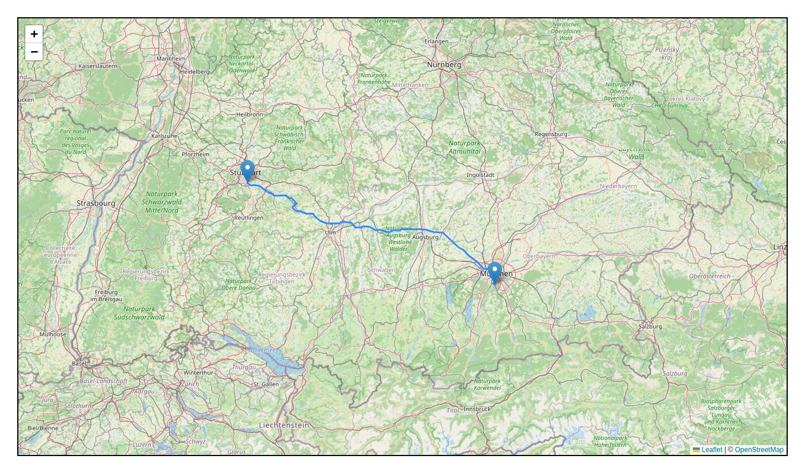

# Web-based Route Planner

Shortest-path routing on the full road network of Germany (25 million nodes, 50 million
edges), with a self-written Dijkstra in Java, a Spring Boot REST API and an Angular +
Leaflet map in the browser.



## About this project

I built this in a team of two between April and June 2022, during the
*Programmierprojekt* (programming project) course at the University of Stuttgart in the
summer term 2022.

**The assignment:** implement a route planner without any routing library. The course
provided an OpenStreetMap road graph of Germany in a plain-text format (`.fmi`). The
work came in two phases:

1. **Benchmark phase:** read the graph, find the node nearest to a coordinate, and
   answer one-to-one and one-to-all shortest-path queries. Results and timings were
   checked against reference solutions.
2. **Web app phase:** make the planner usable in a browser. Click two points on a map
   and see the route.

**The constraint:** everything had to run on a machine with **8 GB of RAM**. Loading
25 million nodes and 50 million edges naively doesn't fit into that, so the graph
data structures had to be designed for memory first.

**My part:** the graph data structures and their memory optimization, and the web app
(the Spring Boot REST API and the Angular/Leaflet frontend), plus the build and
release setup.

This repository is kept as it was finished in 2022 and isn't maintained. The
dependencies (Spring Boot 2.7, Angular 13) are dated.

## Features

- Click on the map to snap to the nearest node of the road graph.
- Click a second point to get the shortest path, drawn on the map as GeoJSON.
- Command-line benchmark for graph loading, nearest-node lookup, one-to-one and
  one-to-all Dijkstra.

## How it works

```
Browser (Angular + Leaflet)
   │  GET /nearest-node?latitude=…&longitude=…
   │  GET /shortestpath?source-node=…&target-node=…   → GeoJSON LineString
   ▼
webapp/      Spring Boot REST API, serves the built frontend, loads the graph at startup
   │
   ▼
pathfinder/  Graph reader, adjacency array, Dijkstra, nearest-node lookup, benchmark
```

- **Graph storage:** the first version kept one `List<int[]>` of edges per node, which
  creates millions of small objects. It was replaced by an adjacency array: one offset
  array that points each node to its first edge, plus a single edge array. Edge costs
  were changed from `double` to `int`. This brings the Germany graph within an 8 GB
  heap.
- **Shortest path:** Dijkstra with an indexed min-priority queue, one-to-one with
  early stop when the target is settled, and one-to-all.
- **Nearest node:** filters the nodes to a small square around the click before
  comparing distances.
- **Startup:** the graph (about 3 GB of text) loads in about a minute. A Stuttgart →
  Munich query takes about 10 seconds on a current laptop.

## Tech stack

Java · Maven (multi-module) · Spring Boot 2.7 · JUnit 4 · Angular 13 · TypeScript ·
Leaflet · OpenStreetMap tiles

## Getting started

**Prerequisites:** a JDK and Maven (last built in 2026 with JDK 27 and Maven 3.8).
Node.js is downloaded by the build. You need the graph file `germany.fmi`. It was
provided by the course and isn't part of this repository. `webapp/src/main/resources/toy.fmi` shows the format.

```bash
./build.sh                        # builds pathfinder, frontend and webapp into one jar
./start.sh /path/to/germany.fmi   # starts with an 8 GB heap
```

Wait for `Data loaded successfully. Service is ready at http://localhost:8083.`, then
open <http://localhost:8083>.

**Benchmark:**

```bash
cd pathfinder
./build.sh
./benchmark.sh <graph.fmi> <queries.que> <longitude> <latitude> <source-node-id>
```

## Project structure

| Folder | Content |
|---|---|
| `pathfinder/` | Graph reading, data structures, Dijkstra, nearest-node lookup, benchmark, tests |
| `webapp/` | Spring Boot application and REST controller |
| `frontend/` | Angular app with the Leaflet map |

## What I learned

- Designing data structures for a hard memory limit: measuring memory use, then
  replacing per-node lists of objects with flat primitive arrays until 50 million
  edges fit.
- Implementing Dijkstra efficiently, with an indexed priority queue instead of a plain
  one.
- Connecting a Java backend and a single-page frontend through a REST API and
  shipping both as one jar.
- Working in a team with feature branches, pull requests and release branches.
